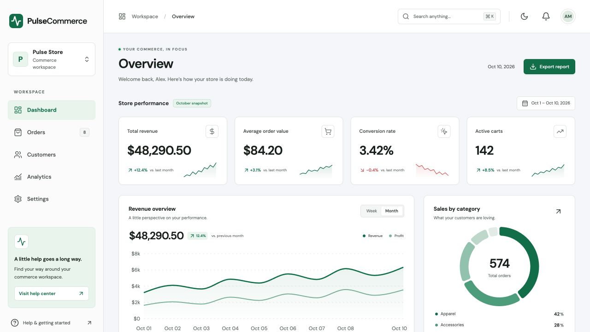

# PulseCommerce

**Commerce, in focus.** A responsive analytics and order management dashboard for US direct-to-consumer brands.

PulseCommerce brings sales performance, customer information, and order operations into one workspace. It pairs an understated SaaS interface with practical tools for finding orders, comparing revenue trends, and exporting data.



## Features

### Business overview

- Four KPI cards: total revenue, average order value, conversion rate, and active carts, each with a compact trend sparkline.
- Interactive revenue and profit chart with weekly/monthly controls and hover tooltips.
- Product category breakdown with a doughnut chart and a detailed analytics view.
- Acquisition channel performance and a current date indicator.

### Order management

- Search by customer name, email, or order number.
- Filter orders by Fulfilled, In Transit, Pending, or Refunded status.
- Sort by date or amount in either direction.
- Paginate with 5 or 10 records per page.
- Select individual orders or an entire page and export the selected or filtered records as CSV.
- Open an order to inspect its destination, amount, activity, and item count, then update its status.

### Workspace experience

- Five views: Dashboard, Orders, Customers, Analytics, and Settings.
- Searchable customer directory with order details.
- Global search with **⌘K** on macOS or **Ctrl+K** on Windows/Linux.
- Notification center, workspace preferences, and light/dark themes.
- Responsive mobile navigation, keyboard controls, accessible dialogs, and reduced-motion support.
- US localization: USD amounts, `MM/DD/YYYY` dates, two-letter state codes, and five-digit ZIP codes.

## Stack

| Layer | Technology |
| --- | --- |
| Interface | React 19 + TypeScript |
| Build | Vite 7 |
| Styling | Tailwind CSS 4 + CSS custom properties |
| Charts | Recharts |
| Icons | Lucide React |
| Tests | Node.js test runner |
| Hosting | Vercel |

## Getting started

Use **Node.js 22.18+** and **pnpm 11.25.0**.

```bash
git clone https://github.com/inzhusalim/pulsecommerce.git
cd pulsecommerce
pnpm install --frozen-lockfile
pnpm dev
```

The development server prints its local URL. No environment variables or external service credentials are required.

## Commands

| Command | Purpose |
| --- | --- |
| `pnpm dev` | Start the development server |
| `pnpm test` | Run the order and localization tests |
| `pnpm build` | Check TypeScript and build the production bundle |
| `pnpm preview` | Serve the production build locally |

## Project structure

```text
src/
  App.tsx          Workspace shell, navigation, search, customers, and settings
  Orders.tsx       Order table, pagination, selection, and order details
  components.tsx   KPI cards, charts, dialogs, and shared UI
  data.ts          Typed sample data and US formatting helpers
  order-utils.ts   Search, filtering, sorting, and CSV serialization
  styles.css       Responsive layouts, theme tokens, and interaction states
tests/
  orders.test.mjs  Data operation and localization tests
public/
  favicon.svg      Application icon
```

## Data and persistence

This project is a standalone frontend demonstration. Reports use a sample dataset for **October 1–10, 2026**; the header date follows the browser’s current local date. Order status changes, theme, workspace details, and notification read states are saved in browser `localStorage`.

Order exports follow the current filters and selection. The top-level **Export report** control downloads every order, while customer exports contain the matching customers’ order records. CSV serialization preserves ZIP codes and decimal precision, escapes quoted fields, and guards against spreadsheet formula interpretation.

Notification preferences are saved locally. The application does not send email, process payments, or synchronize with a live store.

## Deploy to Vercel

Import the GitHub repository into Vercel. The included `vercel.json` specifies the Vite framework, `pnpm build` command, and `dist` output directory. Connect the `main` branch for production updates and use other branches for previews.

## Validation

The test suite covers combined search/status filters, deterministic date and amount sorting, pagination, CSV escaping and US formatting. The interface has been checked at desktop, tablet, and mobile breakpoints, including dark mode and persistence after reload.
